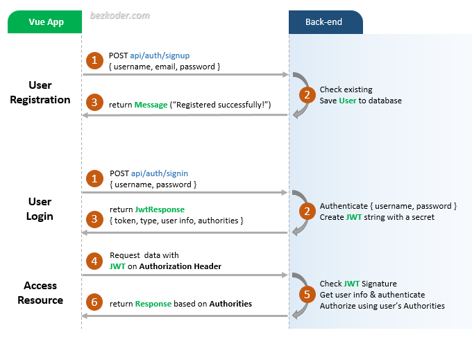

# MassNetCampaignFrontend


# Recommended configuration for the frontend application setup


## Requirements

1. node >= 16.10

## Flow for User Registration and User Login



```bash
git clone https://github.com/uonafya/MassNetCampaignFrontend
```

# Navigate to your local directory.
## Compiles and hot-reloads for development

```bash
cd MassNetCampaignFrontend

yarn install

```
# Launch the app.
```shell

yarn serve

    

### Customize configuration
See [Configuration Reference](https://cli.vuejs.org/config/).


